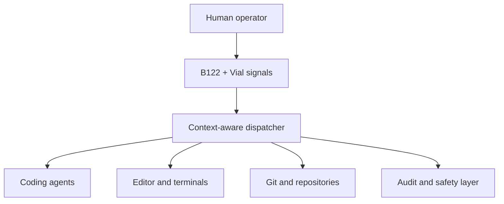

# STRATHEX SWITCHYARD

**SXSY-B122** is a development-stage effort to turn a Model F Labs B122 beam-spring keyboard into a physical routing and control station for agentic software development. The project is being developed privately and is intended for open-source publication after physical commissioning and release-readiness review.

> Route attention. Direct agents. Keep the operator in command.

## What this project is

Modern coding work increasingly happens across editors, terminals, repositories, worktrees, browser sessions, and multiple coding agents. SXSY-B122 explores whether a large programmable terminal keyboard can make that control loop faster, clearer, and safer.

The project combines:

- a Model F Labs B122 beam-spring keyboard;
- its RP2040-based Leyden Jar controller and Vial/QMK firmware lineage;
- Vial key assignments;
- context-aware Windows automation;
- an evidence-based 22-key operator layout;
- exact-scale relegendable key inserts; and
- a documented usability study rather than a speculative macro list.

The physical keyboard is manufactured by Model F Labs. STRATHEX SWITCHYARD is an independent community project and is not affiliated with, sponsored by, or endorsed by Model F Labs, IBM, Vial, QMK, Microsoft, OpenAI, Anthropic, or any other referenced project or company.

## System designation

```text
STRATHEX SWITCHYARD
SXSY-B122

AGENTIC OPERATOR STATION
UNIT 001
COMMISSIONED 2026-08
```

| Field | Value |
|---|---|
| Project | STRATHEX SWITCHYARD |
| System | SXSY-B122 |
| Hardware platform | Model F Labs B122 |
| Installation | Unit 001 |
| Control software | Switchyard Control System |
| Keymap | Switchyard Operator Layout |

## Architecture



The keyboard should express durable operator intents such as *switch session*, *interrupt*, *review changes*, or *resume work*. Host automation decides how those intents apply to the active tool. This keeps the physical control vocabulary stable even as applications change.

## Current status

**Private incubation / Phase 0 - project foundation and workflow study.** The fabrication pipeline for exact-scale inserts has been proven with a first physical-layout prototype. Its command map was intentionally rejected as too IDE-centric. The next layout will be derived from observed agentic work during a structured workflow study.

No keymap, firmware image, or host automation in this repository should yet be treated as production-ready.

The repository should remain private until the B122 has arrived, Unit 001 has completed an initial physical commissioning pass, core attribution and licensing records have been audited, and the maintainer explicitly approves a public release candidate.

## Design principles

1. **Observe before mapping.** Controls must come from real repeated behavior.
2. **Human authority is explicit.** Interrupts, permissions, and consequential actions remain understandable and reachable.
3. **Stable intent over app-specific shortcuts.** Vial emits distinct signals; the host interprets them contextually.
4. **Reproducibility over desk-tour aesthetics.** Publish sources, mappings, decisions, tests, and failures.
5. **Attribution is part of the architecture.** Every borrowed component or claim is traceable to a primary source.
6. **Safe defaults.** A macro must not silently turn an ambiguous context into a destructive operation.

## Documentation map

- [Project charter](docs/01-project-charter.md)
- [Hardware and software architecture](docs/02-system-architecture.md)
- [Workflow study protocol](docs/03-workflow-study.md)
- [Control taxonomy requirements](docs/04-control-taxonomy.md)
- [Publication roadmap](docs/05-roadmap.md)
- [Publication gate](docs/06-publication-gate.md)
- [Attribution register](ATTRIBUTION.md)
- [Source bibliography](docs/references/bibliography.md)
- [Third-party material policy](third-party/README.md)
- [Security policy](SECURITY.md)
- [Contributing guide](CONTRIBUTING.md)

## Project history

The first insert sheet solved the manufacturing problem but not the interaction problem. It demonstrated that community-supplied geometry could be preserved, populated, rendered, inspected, and printed at exact A4 scale. It also over-weighted conventional IDE actions and under-weighted agent sessions, context switching, interruption, review, permissions, and worktree navigation.

That failed taxonomy is retained as design evidence. SXSY-B122 will measure what survives real use rather than presenting the first attractive keymap as a finished system.

## Upstream projects

This work stands on contributions from the keyboard and open-source communities, especially:

- [Model F Labs B122](https://www.modelfkeyboards.com/product/beam-spring-b122-keyboard/) and the [Model F Labs manual](https://www.modelfkeyboards.com/manual/)
- [The Leyden Jar controller](https://github.com/mymakercorner/Leyden_Jar) by Rico / mymakercorner
- [Vial GUI](https://github.com/vial-kb/vial-gui) and [Vial-QMK](https://github.com/vial-kb/vial-qmk)
- [QMK Firmware](https://github.com/qmk/qmk_firmware)
- Relegendable-key templates by **cyber_engineer** (`@Mates_ENGINEER`), supplied with permission to edit, remix, and redistribute with requested credit

See [ATTRIBUTION.md](ATTRIBUTION.md) for the contributor lineage, file-level use, licenses, and modifications.

## Licensing status

The repository is intentionally not under one blanket license yet. Original code, documentation, artwork, firmware-derived material, and third-party assets have different licensing needs. Until file-level notices are added, no permission should be inferred for original SXSY-B122 material beyond GitHub's minimum rights to view and fork a public repository. Third-party material remains under its own license or permission terms.

The planned structure is documented in [LICENSING.md](LICENSING.md).

## Contributing

The project is in an evidence-gathering stage. Workflow observations, B122/Vial compatibility findings, documentation corrections, and reproducible test results are especially useful. Read [CONTRIBUTING.md](CONTRIBUTING.md) before opening a contribution.

---

**SXSY-B122 / UNIT 001**

Maintainer: Alex Kaper

STRATHEX, Inc.
