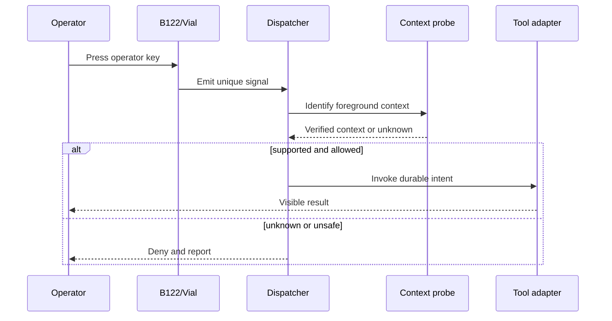

# System Architecture

> **Status:** This is the project-level architecture. The software-only
> implementation uses the TypeScript protocol, Windows companion, VS Code
> bridge, and durable control-plane packages described in
> [software-only-completion-audit.md](software-only-completion-audit.md). It
> does not claim that the physical or provider layers are commissioned.

## Layers

| Layer | Responsibility | Planned artifacts |
|---|---|---|
| Physical | B122 switches, relegendable caps, solenoid, controller | hardware inventory, photos, fit tests |
| Firmware/configuration | Unique physical signals and base layers | Vial export, signal map, firmware source if modified |
| Dispatcher | Convert a signal plus verified context into an intent | TypeScript protocol, Windows companion, durable policy/runtime, tests |
| Adapters | Apply intents only through mediated boundaries | VS Code bridge, typed terminal/provider/Git/credential/network interfaces, safe mocks |
| Safety | Deny unknown contexts; guard consequential actions | policy, confirmation state, interrupt tests |
| Evidence | Record mappings, versions, outcomes, and trials | manifests, logs, benchmark summaries |

## Control path

## Durable intents

The physical labels should describe stable operator goals, not brittle implementation details. A `HALT` key may send Ctrl+C to a known terminal, use an agent-specific interrupt action in a supported client, or refuse to act when the foreground context is unknown. The legend remains `HALT`; the adapter owns the implementation.

## Safety model

- Unknown foreground process: deny by default.
- Destructive action: never bound to a single unguarded tap.
- Approval: scope must be visible; blanket approval is out of scope.
- Context transition: re-evaluate at execution time, not only key-down time.
- Logging: record intent, adapter, outcome, and error without storing secrets or captured prompt content by default.
- Recovery: every installation step must have a documented rollback.

## Trust boundaries

SXSY-B122 does not make third-party agents trustworthy. It creates a deliberate local interface for supervising them. Agent output, generated commands, repositories, and external services remain outside the trusted core. The dispatcher must not infer that an action is safe merely because it originated from a known application.
