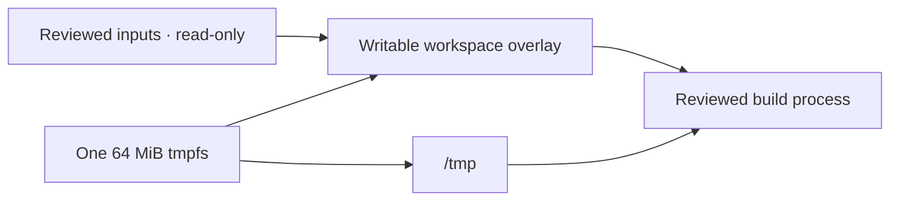

# Bounded build workspaces

Linux Run and pipeline recipes can opt into a writable copy of their exact
reviewed inputs. Builds can generate files and run those results while the live
repository and immutable staged inputs remain unchanged. This is a backend
capability; the frozen frontend does not expose its control yet.

## Select the permission

In the selected `sxsy-b122.repository-runtime` process recipe, add:

```json
"workspaceMode": "temporary-build"
```

The recipe must use disposable isolation and list exact non-production input
paths, byte counts and SHA-256 hashes. The manifest and those files must belong
to the same current task grant. Review shows `bounded-writable-copy`, its 64 MiB
temporary bound and `hostRepositoryWritten: false`. Its one-use approval and
protected checkpoint bind that permission to the manifest/task/target; a raw
request cannot override it. Omitting the field keeps the Suite's read-only
workspace. Explicit `read-only` is also supported by this connected Linux path.

Bubblewrap must provide `--overlay-src`, `--overlay`, sized tmpfs and user-namespace
disabling. This workstation's 0.13.1 passes the native boundary checks. Ubuntu
24.04's older distribution package lacks the overlay API; release CI builds
[upstream 0.13.1](https://github.com/containers/bubblewrap/releases/tag/v0.13.1)
from the official checksum-pinned archive only on its disposable worker. The
distribution AppArmor policy denies capabilities to ordinary helper children.
The two-level setup additionally requires the fixed `/usr/bin/bwrap` executable
to inherit its setup profile on re-entry. CI adds that one exact-path rule only
on its disposable worker; all other children retain the capability-denying
stack, and the final sandbox still disables nested user namespaces. This scoped
integration awaits native CI acceptance; no workstation policy or kernel limit
is changed, and unsupported setup never permits a weaker execution path.

The runtime and namespace host must enable the extension. A manifest alone cannot
make a legacy/direct host runtime writable or substitute host execution when
isolation is unavailable. This extension is Linux-specific; Windows retains its
separate [reviewed guest catalog](windows-pipelines.md) and bounded exchange path.

## Where writes go

The host stages only reviewed bytes and pins the executable through an open
file descriptor. An outer Bubblewrap namespace creates a single 64 MiB tmpfs.
The inner namespace overlays the read-only staged inputs with its upper/work
folders and maps a sibling folder to `/tmp`. Thus build writes, copied-up source
files and temporary files consume the same kernel quota. The live repository,
original input copy and selected executable remain unchanged.



The outer namespace has a separate 4 MiB setup `/tmp` for constructing the inner
boundary; it is not mapped into the final process. Control storage and lower
input paths are hidden. The generated root/device filesystems are read-only,
networking is isolated, ambient credentials are absent and nested user namespaces
are disabled. Filling the shared filesystem returns ENOSPC. The implementation
uses the installed Bubblewrap and pinned executable without copying a runtime,
adding a mount rule or changing a host sysctl.

Generated files disappear with the namespace. Standard output follows the existing
bounded/redacted result and authenticated pipeline evidence path; this feature
does not introduce artifact export or write-back to the live repository.
Separate reviewed local-commit and host-effect paths retain their own authority.

## Ownership and verification

Both namespace levels belong to the original native guardian. Stop/cancellation
uses that exact ownership; a lost reply cannot replay the build. Independent
exit precedes removal of the original staged files. Changed/unfamiliar staging
still requires reconciliation rather than recursive replacement cleanup.

Three capability/manifest/native cases verify disabled-host refusal, exact
input requirements, actual build execution, original input preservation, aggregate
workspace-plus-`/tmp` ENOSPC, hidden paths, read-only root/device writes, denied
nested namespaces, a supported explicit read-only declaration and unchanged host
namespace settings. Two real namespace pipeline cases exercise both actions,
one-use approvals, permission-bound checkpoints, duplicate receipts and stop
cleanup. Their new groups, the existing Run/Suite/package cases and parser/
guardian/inventory regressions pass; type checking passes.

Actual kernel testing uses Linux Bubblewrap 0.13.1 on the pilot. Other host/kernel
acceptance and a full independent assessment remain separate. The repeatable
installed proof accepts `--temporary-build`:

```sh
mise exec node@24.14.0 -- node scripts/verify-repository-execution-host.mjs \
  --synthetic --temporary-build --compartment=execution-validation-build-unique
```

Use a fresh `execution-validation-...` name. The verifier creates one empty native
Codex task with zero prompts, exercises reviewed Run/stop and restores the original
workspace/modes/private endpoint. Its current installed build demonstration is
pending; do not infer it from the source/kernel tests alone.

Normal installed `50dd23d`, release
`fa150bd32f710676b214d7180f251a5f17c497cc17340751f6a24566dad7e03a`,
passes six update checks and this ten-check Run/stop journey. It submits zero
model prompts and independently stops three owned guardians. Original workspace,
modes, definitions, private endpoint and frozen Home are preserved; owned
staging, bundle and source proof checkout are removed. Small receipts
`assignment-legends-1793851542323.json` and
`installed-repository-execution-1793851723364.json` are retained privately.
The installed proof covers Run/stop; both writable pipeline actions have their
separate actual namespace/source evidence above.
