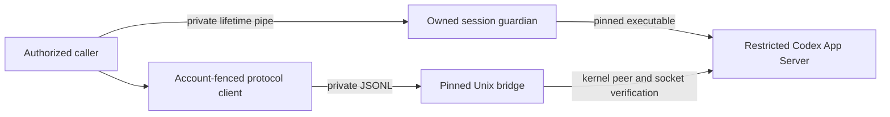

# Connect to an owned Codex listener

Switchyard's production Codex task and design adapters still use restricted
stdio. The new argument builder preserves those exact tool, hook, MCP and
first-party restrictions and can also describe one explicit local Unix listener.
It refuses network endpoints, path aliases and an unspecified/global transport.
No production task is switched to a listener by this change.

The installed 0.166.0 CLI was exercised with an owned private directory and
process group. Its Unix listener uses a socket named by the SHA-256 of the
requested path. The probe checked the native executable hash, process birth,
private socket ownership and the socket inode held by that exact server before
connecting through the existing WebSocket adapter. Two read-only account
responses matched. The process exited, its socket retired and its owned directory
and marker were removed. No thread, model turn, account change or global daemon
command was requested. [Exact source-bound evidence](evidence/codex-owned-unix-summary.json).

The [official App Server documentation](https://learn.chatgpt.com/docs/app-server#protocol)
describes WebSocket framing over Unix sockets. The CLI's separately advertised
stdio proxy did not complete initialization in either bounded trial; those
failures remain retained and that route is not exposed by the app.

The subsequent guardian demonstration also reads back the effective restricted
configuration and kills only its own wrapper. Independent readback confirms that
the existing guardian contains parent loss, with no live member left in its
owned session. Exact socket, native alias, directory and marker retirement pass.
Four native checks and eighteen software checks pass; the initial alias-cleanup
failure stays failed. [Exact guardian evidence](evidence/codex-owned-guardian-summary.json).

Run the explicit read-only proof from the repository with its supported Node:

```sh
node scripts/verify-codex-owned-listener.mjs --read-only-parent-loss
```

The proof pins the reviewed native CLI digest and refuses a pre-existing socket
or active marker. It creates no thread or turn and never starts/stops a global
daemon. It reads existing account metadata and deliberately kills only its new
wrapper; interrupted cleanup preserves exact owned scope metadata for recovery.

## Pinned persistent connection

The new internal Unix bridge verifies Linux `SO_PEERCRED` PID/UID, native process
birth, the executable bytes read through `/proc/PID/exe`, and the original private
socket device/inode before sending a WebSocket handshake or provider request.
It rechecks those identities after connecting. There is one explicit local socket,
with no network or global-daemon fallback. The fixed system Python carrier uses
isolated mode, no new privileges, a parent-death signal and an initial parent
identity guard; it installs no dependency or runtime.

Bounded JSONL/WebSocket framing carries the existing `CodexClient` protocol.
Fragmentation, UTF-8 and ping payloads are preserved; wrong handshakes, masks,
reserved bits, oversized frames and unsupported messages disconnect. The carrier
does not select a task/account, execute tools or grant permissions. Existing
account-epoch fences close pinned requests on account notifications, and existing
server-request handling continues to deny tool approvals.

Seven related complete software files pass 95 tests; the final bridge file passes
all seven cases, including kernel peer refusals before any provider request and
real carrier exit after abrupt owner loss. Typecheck and package/inventory
contracts pass. Six Linux-only bridge tests are explicitly skipped on Windows;
binding validation remains portable.

The installed native CLI also passes four checks using one persistent connection:
effective restrictions, account revalidation, peer exit and exact owned retirement.
Three read-only account requests include the existing bounded startup settle;
two final pinned samples verify. No login, task or model request is made.
[Exact current source and native evidence](evidence/codex-pinned-unix-summary.json).

## Own the provider lifetime

The lifetime controller now reserves a private directory, authenticates the
original CLI bytes through an open executable descriptor, and records the exact
guardian before acknowledging native startup. Admission runs again before that
acknowledgement and connection initialization. Startup refuses repositories,
project configuration and instruction markers; repository permission checks
remain explicit later operations.



This persistent role lives only while its original parent pipe remains open;
generic native commands keep their existing deadlines. Its fixed protocol
accepts no arbitrary command or provider arguments. Account boundaries close all
connections and the owner, and later connections cannot replace the original
fingerprint. Loss of the last control connection also closes the owner.

Stop first closes bridges, then independently verifies the original guardian and
owned session have exited. Only matching socket, native alias and directory
identities may retire. Unfamiliar entries remain intact and retirement stays
unconfirmed. Saved ownership can retire after parent loss only once independent
scope readback confirms exit; recovery never adopts or kills another process.
This is a fixed provider lifetime, rather than general workload containment.

Eight related software files pass 104 tests, including the complete nine-case
lifetime file. It covers admission-before-effect, pending-start cancellation,
account revocation, unsafe configuration, unfamiliar-file preservation, recovery
and a descendant in another process group within the owned session. Eight
Linux-only cases have declared Windows skips; incomplete-request validation is
portable. Typecheck and the expanded manifest pass.

The installed CLI passes four native checks across two owned lifetimes, three
persistent metadata clients, normal stop and abrupt parent loss/recovery. The
normal phase makes five account-read requests. No thread, model turn, login
change, global daemon command or hardware access is requested. All owned stages
and markers retire. Run the explicit proof with:

```sh
node scripts/verify-codex-owned-lifecycle.mjs --read-only-lifetime
```

[Exact lifetime source and evidence](evidence/codex-owned-lifetime-summary.json).

Account-change fencing and owned lifetime management are implemented and
software-tested. Live controlled account switching remains unaccepted.
Production task/design routes still use stdio; complete Studio/task/IDE wiring
remains unfinished software. No saved task authority is inferred from socket
ownership, native version or matching account snapshots.

## Explicit task adapter

`createCodexUnixTasks` reuses the existing exact-root, restricted-configuration,
account-epoch and metadata-only task operations with an owned Unix listener.
The shared task layer accepts asynchronous factories with early ownership
registration, rechecks permission before initialization, and stops a complete
listener owner before accepting replacement. An unconfirmed exit or unknown
private file preserves the original owner and blocks replacement.

The actual installed CLI task-adapter demonstration is reproducible with
`node scripts/verify-codex-unix-tasks.mjs --read-only-account`. It reads the same
account twice, revokes only its verifier permission, and verifies exact shutdown
and staging removal. It creates no thread and submits no model turn. The verifier
permission boundary is separate from production protected-store composition.
[Exact evidence and remaining integration](evidence/codex-unix-task-adapter-summary.json).

The normal Studio still uses stdio. This adapter does not yet supply the durable
per-task owner registry, authenticated IDE attachment, or installed end-to-end
handoff needed to change that default.
