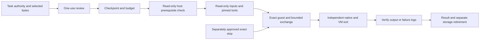

# Reviewed Windows Run and exact stop

The Windows Studio platform factory connects a selected task to an isolated
program run. Task authority, one-use approval, checkpoints and budgets precede
native execution. The live repository is never writable inside the guest, and
program exit never marks the provider's coding task complete.

Normal personal-host privileged storage setup remains unfinished software.
Actual interactive VM acceptance requires a supported Windows Sandbox host;
filesystem CI and runner doubles do not establish that acceptance. The frontend
remains frozen for review.

The Windows helper now embeds its native .NET runtime libraries as well as its
managed code. [Microsoft's single-file deployment contract](https://learn.microsoft.com/en-us/dotnet/core/deploying/single-file/overview)
requires `IncludeNativeLibrariesForSelfExtract` for this packaging. Calls to the
fixed helper receive only validated current-user temporary coordinates in
addition to their explicit environment; runtime startup overrides are refused.
The Windows lane copies only the executable to a new empty directory, removes
installed-runtime discovery paths, runs real metadata through its owned guardian,
verifies independent exit and removes only that proof's copy/cache. This new
native standalone acceptance is pending CI; local runtime/package checks pass.
It does not establish privileged service or VM acceptance.

The metadata-only broker bootstrap is now implemented behind explicit native
CLI modes. An already elevated installer creates a new fixed per-user service,
protected code/key/configuration and a separate System/Administrators-only CLR
extraction cache. SCM configuration, exact image digest and the per-service
environment are read back. The System process seals native file identities,
sizes and hashes before accepting clients. Restarts verify that inventory;
removal first verifies the original SCM configuration, captures its exact native
process handle, observes service and process exit, then deletes only the verified
inventory. Existing or unfamiliar installation state is preserved.

The pipe holds one first instance, refuses remote clients and authenticates the
kernel caller SID before parsing its closed metadata request. Its ACL omits
instance-creation rights for the ordinary client. Every reply is signed against
the installed key and a fresh request nonce. The installer does not elevate the
application, assign privileges to a user or expose any volume/shell verb. Its
metadata continues to say `brokerImplemented: false` because bounded privileged
storage effects and the normal-user setup path remain unfinished.

Helper and linked proof compile without warnings; the sixteen actual crypto
checks and four package checks pass locally, and build scratch was removed.
The new disposable Windows lane installs this exact metadata service, verifies
twelve restricted-client/cache/malformed-pipe boundaries, then observes exact
exit and removal. That native lifecycle proof is pending CI. The per-service
runtime environment and extraction behavior require this actual native check;
managed compilation cannot establish them. No broker service was installed on
the Linux pilot.

The broker metadata wire contract is now implemented separately from the future
privileged service. It accepts only a closed metadata request and binds a fresh
256-bit nonce, installation UUID, owner-scope digest, service-image digest and
request digest to a P-256/SHA-256 signature. The verifier requires the public key
from a separately verified protected installation; it cannot trust a key supplied
in a pipe reply. Duplicate/unknown fields, other curves, changed scopes/images,
wrong keys, replayed nonces and changed privilege claims are refused. Its
readiness statement still explicitly reports `brokerImplemented: false`.

Sixteen actual compiled parser/cryptography checks pass locally and on native
Windows. The filesystem lane retains only its small result, source digest and
assembly digest. The wire proof itself opens no service, volume, account or
guest. The separate bootstrap lane above tests the new service transport.

The protected-file primitive is implemented and compiles without warnings. New
broker files use an Administrators/System owner and protected exact ACLs; the
ordinary client receives only read/execute access to code and public metadata.
The signing-key file excludes the client. Handles reject reparse points, bound
reads and verify the ACL/owner; creation uses the protected descriptor atomically
and reads written bytes back. Its Windows-only CI proof disables privileges and
makes Administrators deny-only using [CreateRestrictedToken](https://learn.microsoft.com/en-us/windows/win32/api/securitybaseapi/nf-securitybaseapi-createrestrictedtoken),
then checks public reads and denied code/config/key/permission writes. That native
proof passes all sixteen checks on native Windows at `366d409`, alongside the
sixteen parser/cryptography checks and existing thirty filesystem checks,
workflow [41924140253](https://github.com/SquirmyWormy275/strathex-switchyard/actions/runs/41924140253).
The broker archive was digest-verified and retained locally as
`windows-broker-protected-files-366.json`, binding the actual merge source
`2173e868`. No service is installed by this check, and its new nonce directory
is removed after verification.



## Declare the exact inputs

A host manifest binds the existing guest catalog to explicit non-production
files. It has exactly these fields:

```json
{
  "schema": "switchyard-windows-reviewed-run/v1",
  "version": 1,
  "recipeId": "run_target",
  "catalogPath": "guest.json",
  "catalogSha256": "<SHA-256 of the exact guest.json bytes>",
  "inputFiles": [
    {"path":"guest.json","sha256":"<SHA-256>","size":123,"classification":"non-production"},
    {"path":"program.mjs","sha256":"<SHA-256>","size":123,"classification":"non-production"}
  ]
}
```

Replace placeholder digests and sizes with the actual bytes. The manifest
cannot approve itself: it and every input must match the separately granted
task snapshot. The selected guest catalog contains one `run_target` recipe,
using the exact host-pinned `C:\B122\tools\node.exe` digest. Its first argument
names a selected `.mjs`, `.cjs` or `.js` file through `{INPUT_ROOT}`. Inline code,
host commands, replacement runtimes and implicit repository copies are refused.

Inputs retain the shared 4 MiB per-file, 64 MiB total and 4,096-file/path bounds.
The recipe limit is nine minutes, leaving a minute inside the ten-minute guest
bound; the encompassing policy deadline can cancel earlier. Captured output is
at most 512 KiB. Credentials, fixed environment overrides, Node startup
injections, unknown tokens and ambiguous paths are rejected. Python, debug,
web and pipeline connections are separate remaining work.

## Own the guest and its storage

After reserving the exact operation, the runner observes the current-user
Sandbox AppExecLink and the native helper's storage privilege before staging.
Metadata opens the process token with `TOKEN_QUERY`, reads at most 256 privilege
entries twice and requires unchanged bytes. It reports only assigned/enabled
flags and whether privileged setup is required. It never enables or grants a
privilege, installs a service, opens a volume or claims containment. This follows
the documented [GetTokenInformation access contract](https://learn.microsoft.com/en-us/windows/win32/api/securitybaseapi/nf-securitybaseapi-gettokeninformation)
and [TOKEN_PRIVILEGES layout](https://learn.microsoft.com/en-us/windows/win32/api/winnt/ns-winnt-token_privileges).

Missing Sandbox support or an unassigned storage privilege settles the consumed
operation as unavailable before input/tool/image staging. A new approval is
required to try again after setup; duplicate requests preserve the original
result. Personal-host privileged setup is still unfinished. Readiness is an
observation, not permission to elevate the application.

The host-only runner stages exactly selected bytes, hard-links the existing
worker and Node image, creates one original fixed-capacity disk and transfers
it once into a trusted writable lease. No runtime-copy fallback is allowed.
Native Sandbox startup pins the original image/mount identities, footer, volume
GUID, exact extent/capacity and three closed mappings. Inputs/tools are read-only;
only the owned exchange is writable. Network and host redirection are denied.
[Native storage contract](windows-bounded-exchange.md).

A kernel lease spans preparation, guest execution and cleanup. Another process
must acquire it before recovery touches the guest; a missing VM during live
preparation is not an abandoned operation. Readiness persists exact ownership
before acknowledgement. Unknown effects cannot replay. Scope changes and durable
exact-operation cancellation markers stop the original owner.

Run admission, eventual program result, independent exit and storage retirement
are separate records. Only the native volume service can detach/remove its
original disk. Generic backend cleanup cannot traverse that mount. A known
program result survives failed storage cleanup; replacement remains blocked
until the original ownership reconciles. General snapshots omit these records.

## Stop and read results

Exact stop has its own confirmation, operation, 120-second Windows budget and
receipt. Its immutable original admission is distinct from the eventual program
result. PIDs, guest IDs and commands are not accepted. This Windows allowance
does not change the Linux stop budget. A lost final write can recover an already
recorded passing receipt. Late exit without that receipt preserves an incomplete
stop result and cannot replay cancellation or the worker.

Successful output is extracted only after exact VM/native exit and manifest,
path, size, digest, resource-field and current-scope checks. Failed v2 results
must also match the independently observed guest exit code, including signed
Windows bits. They may retain only `process.stdout.txt` and
`process.stderr.txt`, within the shared output bound. `diagnosticRoot` is
separate from successful `resultRoot`; the execution stays failed.

Status reads expose redacted text only from those two verified files, inside
the exact operation's owned result directory. Descriptor hashing and directory
identity checks reject changed bytes or substituted roots. Missing/changed
output becomes unavailable without rewriting the original Run result. Unknown
exit releases no diagnostic bytes. These files are untrusted program data and
grant no task authority.

## Verify the boundaries

Thirteen Studio admission/stop/output cases use real task grants, Git inspection,
encrypted ledgers, file reads and kernel locks with an explicit Windows runner
double. The combined policy/inventory/backend/package group passes 66 checks.
Type checking passes. Four cases invoke the actual compiled C# result formatter;
its warning-free build and six Linux native-only guards pass. They validate wire
format and guards, not an actual VM or native Job enforcement.

The Windows policy workflow runs complete policy, recovery, stop, output,
task-authority and host-stop test files as separate jobs. Every file is explicitly
present in the required inventory and retains its existing harness bound. The
four Windows adapter files are capped at five minutes. This follows the first
whole-file run's four-minute timeout: its first four cases completed, but the
run remains failed in `windows-policy-63cb-failed.json`. No case or assertion was
removed. `scripts/verify-windows-policy.mjs --synthetic --suite=policy` selects
one complete group; omitting `--suite` runs them all. It provisions pinned Node
and locked dependencies without a .NET or optional-runtime download, opens no
VM/account/keyboard and retains only a small seven-day receipt.

All four jobs passed at `cdd86cb` in workflow `41914612230`. Digest-verified
`windows-policy-cdd-{policy,recovery,stop,output}.json` receipts retain the exact
results and verified child cleanup. Prerequisite transport/session/runner checks
pass 30/30 locally; the actual Windows token query remains a native CI check.

[Current verification](verification.md) identifies exact source checkpoints,
installed Linux demonstrations and all 30 native Windows filesystem checks.
[The requirement ledger](switchyard-requirements.md) separates unfinished
software from hardware/account acceptance.
