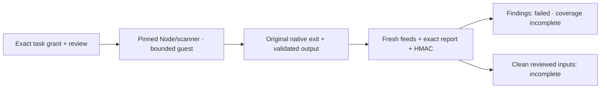

# Windows Shield baseline execution

All four Shield actions now connect the [pinned baseline scanner](shield-baseline-scanner.md)
to the reviewed Windows guest path. This implements the software connection;
actual Windows Sandbox/UAC and account acceptance remain separate. Full Shield
repository/history/ecosystem/provenance coverage remains unfinished on both platforms.

The exact task grant names the selected action. A one-use execution review binds
the source snapshot, input manifest, sole guest catalog, pinned Node runtime,
helper, scanner bytes, request and installed signed feed versions/hashes. The
catalog must run the shipped `.mjs` scanner with exactly one request argument,
from its read-only input root, with `NODE_ENV=test`, no startup injection and no
extra artifacts. Changing the script, request, feeds, action or displayed boundary
requires a fresh review.

The existing protected storage broker and native ownership path provide the
64 MiB exchange, fixed mappings and exit-before-retirement rules. Review labels
that quota as `bounded-exchange`; it does not attest the entire guest operating
system disk. The checkpoint retains the exact displayed execution policy. There is no
automatic elevation, privilege fallback or uncontained substitute. Public feed
bytes belong to the approved input set; signing keys and registry storage are
not mapped into the guest.

The host separately verifies the retained native result, operation/action/scope,
catalog/helper hashes, zero program exit, original result manifest, extraction
directory and exact stdout digest/size. It then validates the closed scanner
report: exact request/feeds/source inventory, findings, counts, coverage gaps and
explicitly incomplete BOM. Signed feeds and current authority are rechecked
before HMAC issuance. Evidence binds both the scanner-report hash and the native
result-manifest hash; they establish different facts.

A known finding produces a failed protected receipt whose coverage stays
incomplete. A clean selected input set also remains incomplete. The same
CycloneDX 1.6 data and npm alias identities are retained for Supply Chain and
Release Shield. Unknown repository scope, uncollected history/permissions or
dependency graph and unverified publisher provenance cannot become a green gate.

Lost observation acknowledgement preserves the original uncertain result.
Recovery may observe the original native program exit but cannot infer a passing
Shield result or replay the worker. Duplicate admission returns the original
protected result.

## Verification

The guest is explicitly doubled in these tests. Real host software exercises
task/Git snapshots, P-256 feed verification, encrypted persistence, one-use
approvals, checkpoints, budgets, exact output files, HMAC receipts and recovery.
The scanner algorithm runs on real synthetic source/feed bytes; this is not a
claim that a VM or interactive Windows account was exercised.

Five independent policy cases exercise all four actions plus clean incomplete
input. The
recovery case refuses alternate working roots, extra arguments/environment/
artifacts, substituted scanner bytes, missing feeds, revocation, malformed
output and lost acknowledgement. Two fast evidence cases cover distinct
report/native-manifest bindings and fifteen scope/source/finding/BOM/native/
feed/authority faults. The existing Windows Run/authority files pass 35 cases;
the shared pipeline/evidence files pass five. New Windows policy/recovery and
the shared actual Linux scanner pass five tests in three independently exited
groups, with every cleanup verified. Package/inventory/evidence checks pass 27.

Each new policy/recovery file keeps its explicit 120-second Linux and
300-second Windows integration bound. Evidence uses the existing default bound.
Focused `shield-policy`, `shield-recovery` and `shield-evidence` Windows CI jobs
are connected. Native Windows execution and the complete updated lane remain
unaccepted until their own results arrive; Linux software tests do not substitute
for them. No physical keyboard, VM, work tenant or new account is opened by these
contract tests.

The earlier native `6a45643` Shield-policy file hit its 300-second deadline; the
failed digest-verified receipt stays failed. Its four action scenarios and clean
case now run in five separately exited groups. The three stop-admission/recovery
scenarios similarly run independently after the earlier stop-file timeout.
Per-child Windows bounds remain 300 seconds; command budgets and every original
assertion are unchanged. Both Windows verifier entry points require the complete
fixed scenario inventory, rejecting a missing, duplicate or broadened selection.
Nineteen selector/runner checks and all eight scenario groups pass locally with
the guest doubled (`isolated-test-a2e0b8c1-ad73-4e98-b009-72ec411d2904.json`).
Every child cleanup verifies. New native Windows acceptance remains pending.
